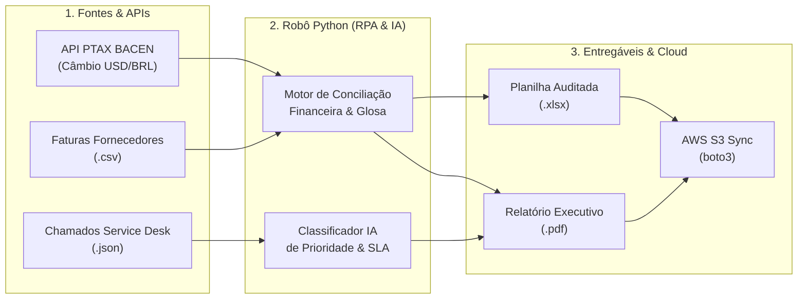

# ⚙️ Enterprise Process Automation (RPA), AI Triage & Cloud Sync (Python · APIs · AWS S3)

[](#)
[](#)
[](#)
[](#)

Pipeline completo de **Automação de Processos Corporativos (RPA / Backoffice), Integração de APIs REST, Classificação Inteligente com IA e Sincronização em Nuvem (AWS S3)** desenvolvido em **Python**.

---

## 🎯 Problema Operacional Resolvido

Equipes financeiras (Contas a Pagar / FinOps) e de Operações de TI gastam dezenas de horas semanais conferindo manualmente planilhas de faturas de fornecedores em dólar/real e fazendo triagem manual de chamados de suporte.

Este projeto automatiza o ciclo inteiro em menos de **2 segundos**:

1. **Integração com API Oficial do Banco Central (PTAX USD/BRL):** Consulta a API OData do BACEN (com fallback resiliente offline) para converter faturas internacionais de Cloud e SaaS.
2. **Robô de Conciliação Financeira e Glosa Automática:** Cruza cada fatura recebida contra o valor contratado e hashes de notas fiscais, bloqueando automaticamente cobranças com variação acima de 5% ou notas fiscais duplicadas.
3. **Motor de Triagem de Chamados com IA/NLP:** Analisa a descrição em texto livre de chamados operacionais, classifica a prioridade (`P1` a `P4`), verifica violações de SLA e define a ação recomendada.
4. **Geração de Entregáveis Executivos (`.xlsx` e `.pdf`) e Upload para AWS S3 (`boto3`):** Gera a planilha auditada em Excel, o relatório de governança em PDF e sincroniza o pacote com bucket S3.

---

## 🏗️ Fluxo da Automação



---

## 📊 Resultados Auditados na Execução Padrão (`seed 42`)

| Indicador Operacional | Resultado |
|---|---|
| **Faturas Processadas pelo Robô** | **60 faturas** (Contratos em BRL e USD convertidos via PTAX) |
| **Faturas Bloqueadas por Divergência / Duplicidade** | **16 faturas** retidas automaticamente para auditoria |
| **Economia / Glosa Financeira Apurada** | **R$ 304,8 mil** evitados em pagamentos indevidos ou duplicados |
| **Chamados Operacionais Classificados via IA** | **45 chamados** triados em severidades `P1` a `P4` com cálculo de SLA |

---

## 🚀 Como Executar

```bash
python pipeline_automacao_corporativa.py
```

Os arquivos gerados ficam disponíveis imediatamente em:
* [`entregaveis_automacao/conciliacao_faturas_rpa.xlsx`](entregaveis_automacao/conciliacao_faturas_rpa.xlsx)
* [`entregaveis_automacao/relatorio_auditoria_rpa_e_ia.pdf`](entregaveis_automacao/relatorio_auditoria_rpa_e_ia.pdf)
* [`entregaveis_automacao/chamados_classificados_ia.json`](entregaveis_automacao/chamados_classificados_ia.json)
* [`cloud_s3_staging/manifesto_s3_sync.json`](cloud_s3_staging/manifesto_s3_sync.json)
